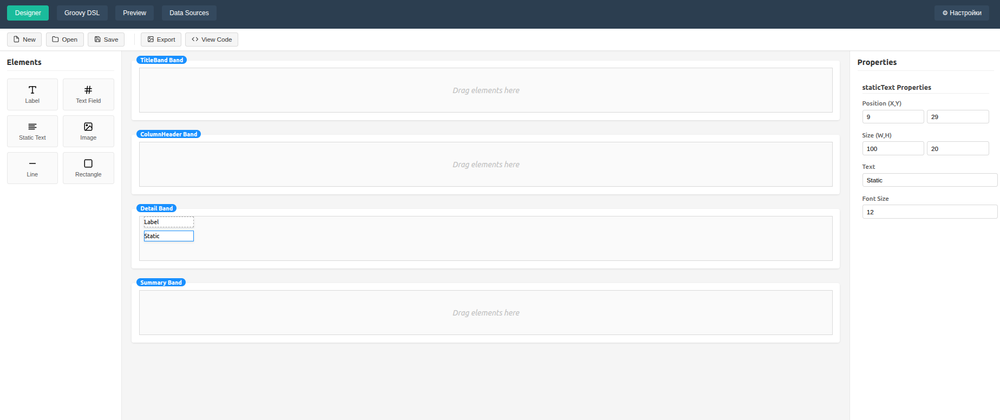
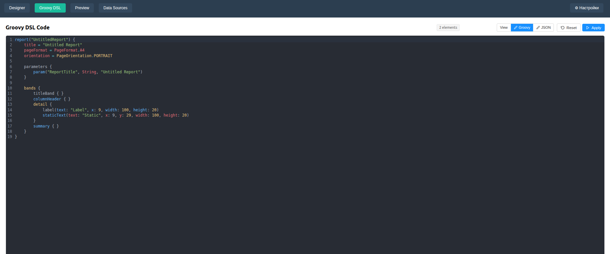
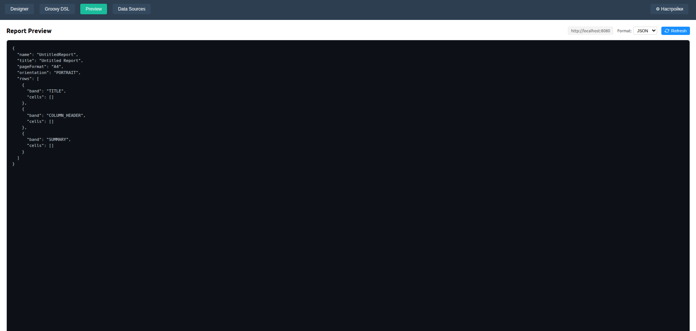
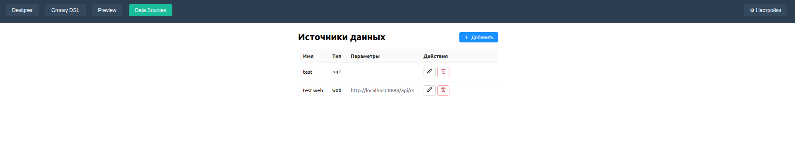

# Report Designer App

# Report Designer App

Веб-приложение для визуального проектирования отчётов на базе [report-design-lib](https://github.com/report-builder-app/report-design-lib).

[](https://react.dev/)
[](https://vitejs.dev/)
[](LICENSE)

---

## Возможности

- **Визуальный дизайнер** — drag-and-drop бэндов и элементов, инспектор свойств, превью в реальном времени.
- **Groovy DSL** — генерация и редактирование кода отчёта с подсветкой синтаксиса.
- **Превью и деплой** — отправка отчёта на бэкенд и получение готового PDF / XLSX / HTML / JSON.
- **Источники данных** — подключение SQL, REST и custom-провайдеров прямо из UI.
- **Экспорт** — скачивание готового отчёта или сохранение шаблона в JSON.

---

## Скриншоты

### Визуальный дизайнер



Основной экран: палитра элементов слева, холст с бэндами по центру, инспектор свойств справа. Элементы перетаскиваются между бэндами, поддерживается изменение размера и позиции.

### Groovy DSL



Вкладка с кодом отчёта. DSL генерируется автоматически из визуальной модели — можно переключаться между режимами и вносить правки вручную.

### Превью и деплой



Превью отчёта через бэкенд (`POST /api/v1/reports/render/html?disposition=inline`) и кнопка экспорта в PDF/XLSX.

### Настройка источника данных



Подключение SQL / REST / custom-провайдера. Кнопка «Test connection» проверяет доступность источника до сохранения.

---

## Запуск

```bash
# Установка зависимостей
npm install

# Запуск в режиме разработки
npm start
# → http://localhost:3000

# Сборка production-бандла
npm run build

# Запуск тестов
npm test
```

## Лицензия

Apache License 2.0 — см. файл LICENSE

JasperReports® and JRXML are trademarks or registered trademarks of Cloud Software Group, Inc.
or its subsidiaries (formerly TIBCO Software Inc. / Jaspersoft Corporation).
This project is an independent converter tool and is not affiliated with, endorsed by,
or sponsored by Cloud Software Group, Inc.